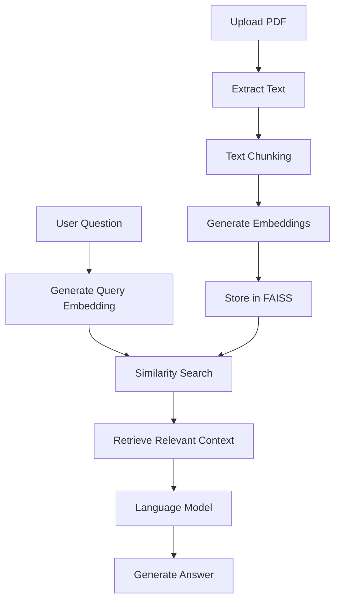

# 🎓 ChatScholar — AI-Powered Academic Assistant

**Making learning smarter through Artificial Intelligence.**

ChatScholar is an AI-powered academic assistant designed to help students interact with educational materials, understand complex concepts, and improve their academic writing. It combines conversational AI, Retrieval-Augmented Generation (RAG), semantic search, and automated essay grading into one platform.

---

## 🌟 Key Features

### 💬 1. Conversational AI
- Interact with an AI-powered academic assistant.
- Ask questions and receive contextual responses.
- Get explanations of complex academic concepts.

### 📚 2. PDF-Based Question Answering (RAG)
- Upload academic documents and PDF files.
- Extract and process document content.
- Split documents into smaller text chunks.
- Generate embeddings for semantic representation.
- Retrieve relevant information to answer questions.
- Generate context-aware responses based on uploaded documents.

### 🔍 3. Semantic Search
- Search academic documents based on meaning rather than exact keyword matching.
- Retrieve contextually relevant information using vector embeddings.
- Leverage FAISS for efficient similarity search.

### 📝 4. Automated Essay Grading
- Evaluate student essays using assessment rubrics.
- Generate structured academic feedback.
- Assess writing quality, organization, coherence, grammar, and relevance.
- Provide scores and recommendations for improvement.

---

## 🧠 Technologies Used

| Technology | Purpose |
|---|---|
| Python | Core programming language |
| Flask | Backend development and web application framework |
| LangChain | LLM application development and orchestration |
| FAISS | Vector storage and similarity search |
| Hugging Face | Pre-trained embedding models |
| Sentence Transformers | Text embedding generation |
| Ollama | Local LLM integration |
| PyPDF2 | PDF text extraction |
| HTML5 | Frontend structure |
| CSS3 | User interface styling |
| JavaScript | Frontend interactivity |

---

## ⚙️ How It Works

ChatScholar combines several AI and NLP techniques to deliver its academic assistance capabilities.

### RAG Pipeline

The PDF question-answering workflow follows these stages:

1. **Document Upload:** The user uploads a PDF document.
2. **Text Extraction:** Text is extracted from the uploaded document.
3. **Text Chunking:** The extracted content is divided into smaller chunks.
4. **Embedding Generation:** Hugging Face models convert text chunks into numerical vector representations.
5. **Vector Storage:** FAISS stores the generated embeddings.
6. **Similarity Search:** User queries are converted into embeddings and matched against relevant document chunks.
7. **Response Generation:** Retrieved context is passed to the language model to generate a relevant response.

### RAG Architecture



---

## 🏗️ Project Architecture

```text
ChatScholar/
│
├── app.py                 # Flask application and backend
├── requirements.txt       # Python dependencies
│
├── templates/
│   └── new_home.html      # Frontend interface
│
├── static/                # Static assets (if configured)
│   ├── css/
│   ├── js/
│   └── images/
│
├── .venv312/              # Python virtual environment
├── app.log                # Application logs (deployment)
└── README.md
```

*Note: The structure above is illustrative. Adapt it to match the actual files in your repository. Do not commit your virtual environment or runtime logs.*

---

## 🚀 Installation and Setup

### Prerequisites

- Python 3.12
- pip
- Git
- Ollama, if using its local language model integration.

### 1. Clone the Repository

```bash
git clone Vedline2547/ChatScholar
cd ChatScholar
```

### 2. Create a Virtual Environment

```bash
python -m venv .venv
```

Activate it:

**Windows:**
```bash
.venv\Scripts\activate
```

**Linux/macOS:**
```bash
source .venv/bin/activate
```

### 3. Install Dependencies

```bash
pip install -r requirements.txt
```

### 4. Configure the Language Model

If using Ollama, install the Ollama runtime, start its service, and download the model configured in your application.

For example:

```bash
ollama pull qwen2.5:3b
```

Ensure the model name in your application matches the downloaded model.

### 5. Run the Application

```bash
python app.py
```

Open your browser:

```text
http://127.0.0.1:5000
```

---

## ☁️ Deployment

ChatScholar was deployed on **Amazon Web Services (AWS) EC2** using an Ubuntu Linux server.

Deployment tools and technologies included:

- **AWS EC2:** Cloud hosting infrastructure.
- **PuTTY:** Remote SSH access and server management.
- **WinSCP:** File transfer between the local machine and EC2.
- **Python Virtual Environment:** Isolated dependency management.
- **Flask:** Application backend.

The application was configured to listen on `0.0.0.0` for external access through the EC2 instance.

---

## 🎯 Project Objectives

ChatScholar was developed to explore how Artificial Intelligence and Natural Language Processing can improve academic learning and student productivity.

The main objectives are:

- Make academic information easier to access and understand.
- Enable context-aware question answering from uploaded documents.
- Apply vector embeddings and semantic search to information retrieval.
- Explore Retrieval-Augmented Generation in practical applications.
- Automate aspects of academic writing assessment.
- Build practical experience in deploying AI-powered web applications.

---

## 🔮 Future Improvements

Potential areas for further development include:

- [ ] User authentication and personalized student profiles.
- [ ] Persistent document storage and conversation history.
- [ ] Support for multiple document formats.
- [ ] Improved RAG evaluation and response accuracy.
- [ ] Advanced essay evaluation using customizable rubrics.
- [ ] Streaming AI responses.
- [ ] Improved application performance and scalability.
- [ ] HTTPS and custom domain configuration.
- [ ] Dashboard for tracking student academic progress.

---

## 🧑‍💻 Developer

**Vedline Ochieng Odhiambo**

Civil Engineering Student | Python Developer | ML Enthusiast | AI Engineer in Progress

Interested in building practical AI solutions at the intersection of Artificial Intelligence, Machine Learning, and Engineering.

- GitHub: [@Vedline2547](https://github.com/Vedline2547)
- LinkedIn: [Vedline Ochieng](https://www.linkedin.com/in/vedline-ochieng-025146290/)

---

## 📜 License

This project is available for educational and research purposes. Add a formal license to the repository if you intend to specify permissions for reuse and distribution.

---

**Built with Python, AI, and a passion for transforming education. 🚀**
